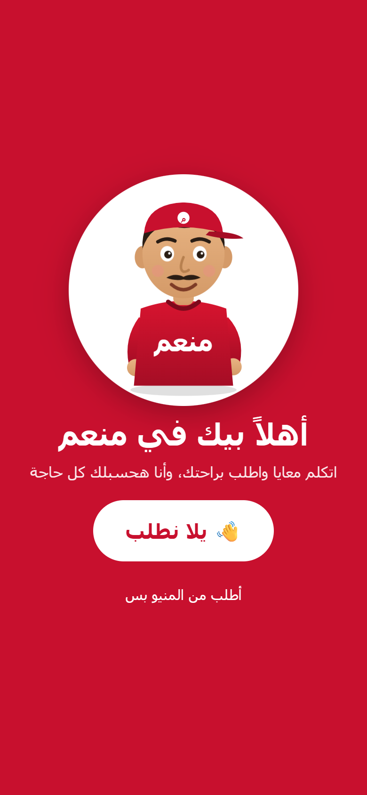
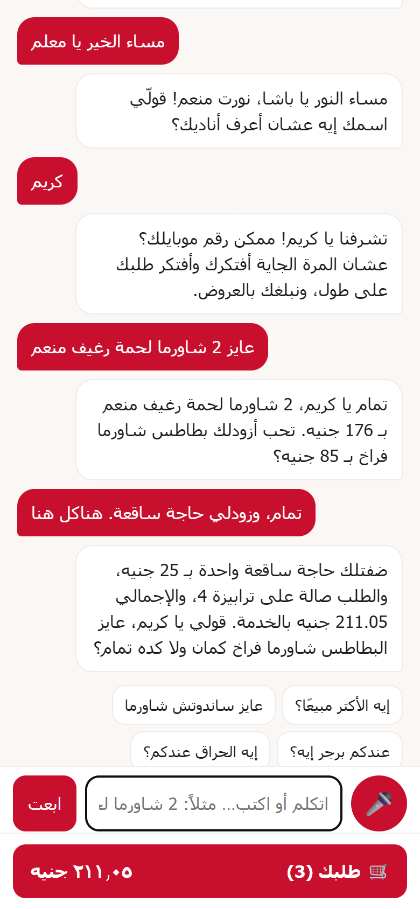
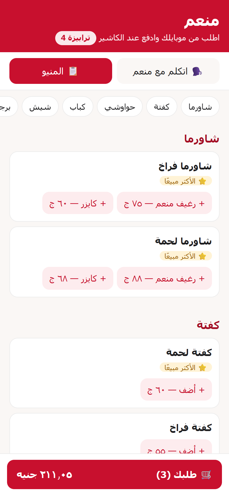
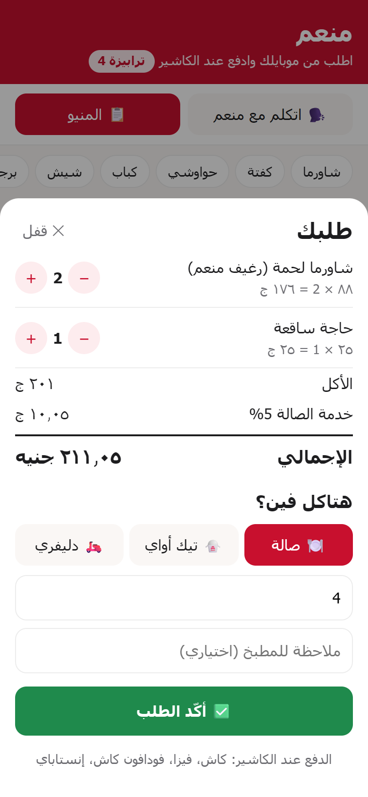
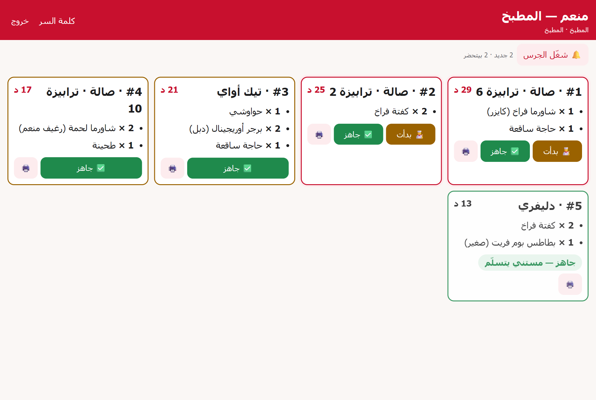
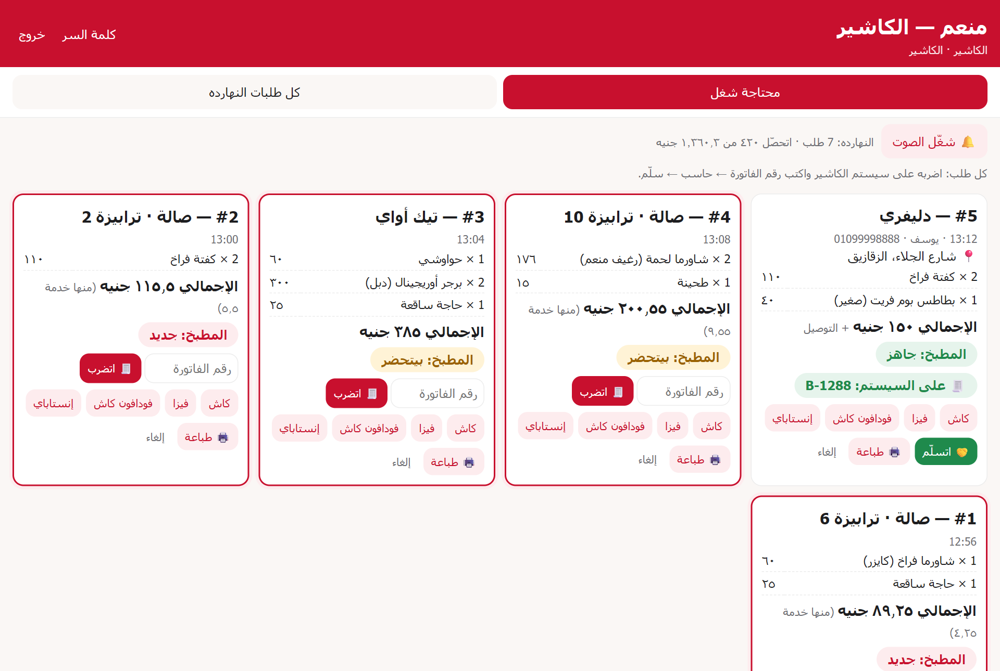
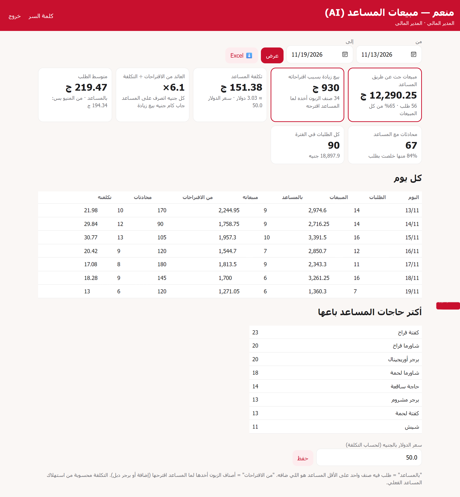
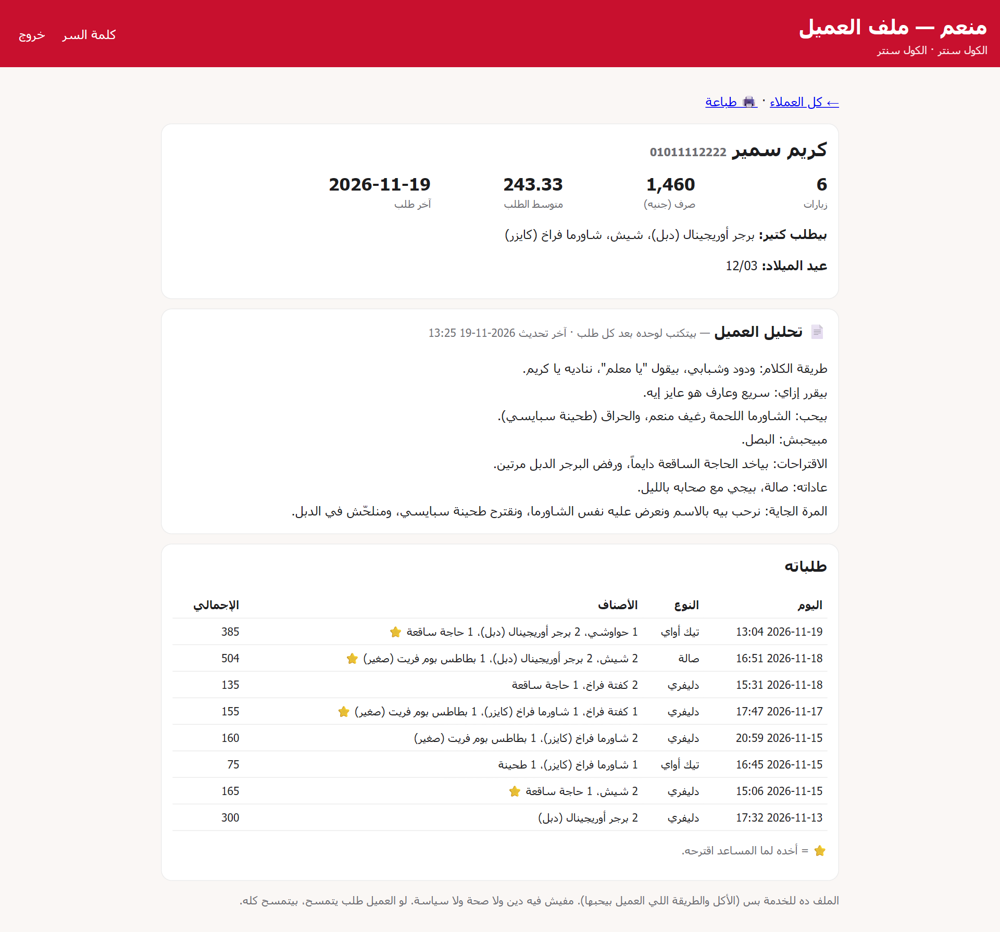
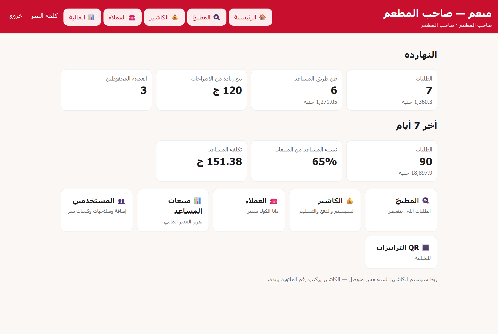

# Menem — AI Voice Ordering Assistant for an Egyptian Restaurant

**A QR-code ordering system where customers talk to an animated assistant in Egyptian Arabic — and it takes the order,
sells, remembers them, and never gets the bill wrong.**

Built for a real grill restaurant in Egypt (shawarma, kofta, hawawshi, burgers). Customers scan the code on their
table and order from their own phone, by voice or text. Orders go straight to the kitchen and cashier screens; the
owner sees what the assistant sells and what it costs.

> This repository is a showcase. The source code is private and available to clients on request.

---

## Screenshots

*All names, orders and figures in the screenshots are demo data.*

| Welcome | Conversation | Menu | The order |
|---|---|---|---|
|  |  |  |  |

**Kitchen screen** — new orders with a bell, minutes since ordering, no prices



**Cashier screen** — bill number from the existing POS, payment method, hand-over



**AI sales dashboard (finance)** — assisted revenue, upsell revenue, model cost and return per day



**Customer profile (call center)** — written automatically after each order, used on the next visit



**Owner overview**



---

## What it does

- **Hands-free voice conversation in Egyptian Arabic.** The character speaks, then listens again by itself — like
  talking to a person at the counter. Customers can also type.
- **Accurate by design.** The language model never does arithmetic: it can only call ordering tools, while prices,
  the dine-in service charge and totals are computed in code. Unknown items or unavailable choices are rejected by
  code, and nothing reaches the kitchen until the customer presses *Confirm*.
- **Sells like a good cashier.** One relevant suggestion at a time (a drink, a side, single → double burger), never
  pushy; every suggestion the customer accepts is tracked.
- **Knows its customers — with consent.** Asks for the name, then the phone number with a clear reason. Returning
  customers are greeted by name and offered their usual order. After every order it writes a short profile: how they
  like to be spoken to, how they decide, what they like, which suggestions they accept.
- **Reads the customer's tone.** Formal customers get respectful language, casual customers a friendly street style,
  women are addressed with feminine grammar.
- **Safe.** No invented facts about the food, no discounts or free items, no politics or religion, resistant to
  "ignore your instructions" tricks; when the microphone mishears, it politely asks the customer to repeat.
- **Five staff roles.** Owner, kitchen, cashier, call center (customer data) and finance (AI sales report).

## Results

| What was measured | Result |
|---|---|
| Live evaluation: 15 real conversations checked by code (exact totals, quantity changes, unavailable items, prompt injection, no invented facts, tone, natural flow) | **15 / 15** |
| Bill accuracy | exact to the piaster, computed in code |
| First audio of a reply (streamed voice) | **under 1 second** after the text is ready |
| Speech-to-text of a customer sentence | about 2 seconds |
| Automated tests | 26 |

**Choosing the model by evidence, not by price tag** — the same 15-scenario exam on three models:

| Model tier | Exam | Cost of the exam |
|---|---|---|
| Largest | 15 / 15 | $0.22 |
| **Mid (chosen)** | **15 / 15** | **$0.12** |
| Smallest | 14 / 15 | $0.008 |

The mid-size model matched the largest one and cut the conversation cost by about **50%**. The finance screen then
tracks the real cost per day against the extra sales the assistant brings.

## How it works

```
customer's phone (QR)
   │  voice ──► speech-to-text (restaurant-aware, noise trimmed)
   ▼
conversation loop — language model with tools:
   add_to_order · remove_from_order · set_order_type · view_order
   set_customer_name · remember_customer · find_customer · note_preference · forget_customer
   │
   ▼
cart & bill in Python  ──►  SQLite (orders, customers, profiles, sessions, AI usage)
   │                                │
   ▼                                ▼
streamed text-to-speech      kitchen · cashier · call center · finance · owner screens
```

## Tech

Python · Flask · SQLite · LLM tool calling · Google Gemini (speech-to-text, streaming text-to-speech) · Azure Speech
(backup voice) · HTML / CSS / JavaScript (mobile first, animated SVG character, Web Audio) · pytest · Cloudflare
Tunnel / WSGI deployment

---

Built by **Salem Yousry** — AI automation engineer with an MBA and four years in the restaurant business.
[github.com/salemyousry4-design](https://github.com/salemyousry4-design)
